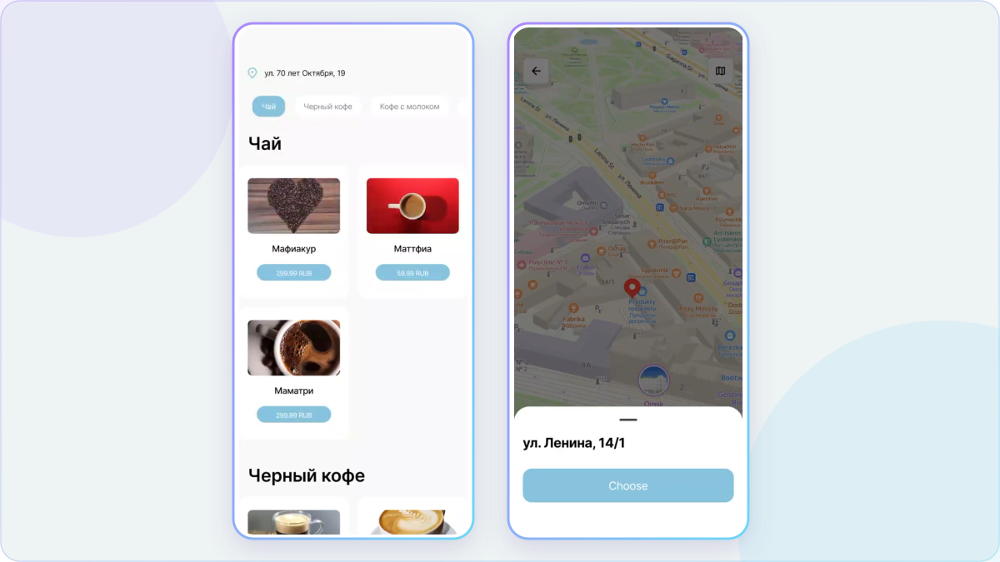
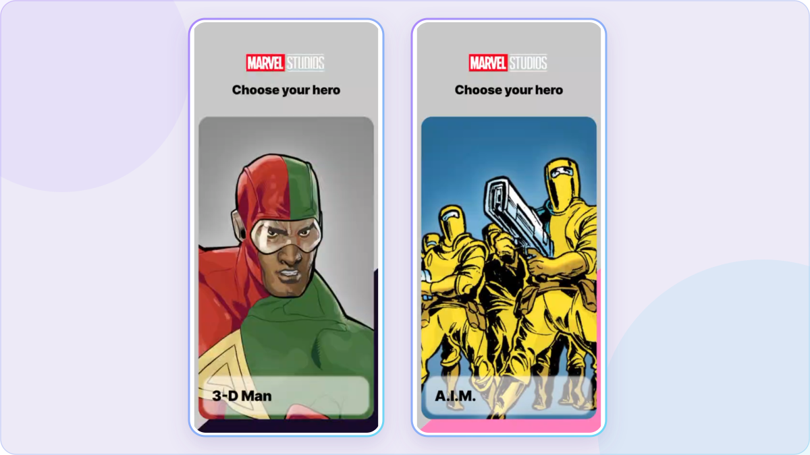

**English** · [Русская версия](README.ru.md)

### Thoughtful architecture. Reliable releases. Interfaces people enjoy.

**3+ years of commercial Flutter development · 4 platforms · 2 developers mentored**

[**Explore my portfolio**](https://portfolio.semenova-anzhelika.online/) · [Résumé — EN](https://portfolio.semenova-anzhelika.online/assets/Anzhelika-Semenova-CV-EN.pdf) · [Резюме — RU](https://portfolio.semenova-anzhelika.online/assets/Anzhelika-Semenova-CV-RU.pdf)

## Hi, I’m Anzhelika — you can call me Lika

I’m a **Middle Flutter Developer** based in Omsk, Russia, working remotely. I build **mobile and desktop applications for iOS, Android, Windows, and macOS**, evolve existing codebases, and take features from requirements through release and post-release support.

My work spans module architecture, API integrations, streamed AI responses, media, payments, and automated testing. I also perform manual functional and smoke testing, write test cases, and test APIs in Postman.

Currently at **Regul Web Studio** (January 2025–present); previously **XNS** (March 2023–December 2024). Russian: native · English: B1.

## Commercial products · my contribution

| Product | What I worked on | Explore |
| :--- | :--- | :--- |
| **Alpina Plus** · books, audio & learning | Nylo → BLoC migration, layer separation, screen performance, background audio, deep links, and progress fixes. | [Cases](https://portfolio.semenova-anzhelika.online/#cases) · [Google Play](https://play.google.com/store/apps/details?id=com.plus.alpina) |
| **AlpinaGPT** · AI tools | Buffered SSE responses with character-by-character rendering, chat history restoration, file workflows, dynamic image actions, and payment UI. | [Cases](https://portfolio.semenova-anzhelika.online/#cases) · [Google Play](https://play.google.com/store/apps/details?id=com.alpina.ai) |
| **EvolverAI** · AI tools for software teams | Independently designed the Flutter architecture; built project setup, tool connections, agent selection, and AI session launch flows. | [Project overview](https://portfolio.semenova-anzhelika.online/#work) |

Earlier at XNS: receipt scanning and QR/referral flows for a cashback service, recipe app cart/search, and fitness app favourites and workout progress.

Commercial products were developed in a team. The links describe my contribution; commercial source code is not published here.

## Engineering highlights

- **Two-month architecture refactoring:** contributed to a Nylo → BLoC migration, separated UI/state/data layers, and tested existing behaviour.
- **A complex bug fixed in one day:** traced a progress handling error that left completed materials marked as unread.
- **Streaming AI interfaces:** buffered SSE chunks and coordinated state with sequential text animation.
- **Mentored two Flutter developers:** code reviews, pair programming, onboarding, and architecture discussions.
- **Four-platform builds:** iOS, Android, Windows, and macOS; mobile delivery through TestFlight, App Store, and Google Play.

[**Explore all seven engineering cases**](https://portfolio.semenova-anzhelika.online/#cases)

## Public projects · explore the code

[**Main projects**](#main-projects) · [**Learning projects**](#learning-projects) · [**Open-source fork**](#open-source-fork)

Start with the Flutter applications below, then explore my Android, iOS and web studies. Each repository includes its own overview, stack and setup notes.

### Main projects

<table>
<tr>
<td width="50%" valign="top">

<h4>Questopia</h4>

Find an adventure. Explore escape rooms, filter results, save favourites and book a visit.

Flutter · Dart · BLoC · Supabase · Hive

<a href="https://github.com/Liker4ik26/questopia"><b>Explore the project</b></a> · <a href="https://portfolio.semenova-anzhelika.online/#personal">Portfolio gallery</a>

</td>
<td width="50%" valign="top">

<h4>Coffeemania</h4>

Your favourite coffee, a persistent cart and nearby cafés — on the map and in a list.

Flutter · Riverpod · SQLite · Dio · Yandex MapKit

<a href="https://github.com/Liker4ik26/coffeemania"><b>Explore the project</b></a> · <a href="https://github.com/Liker4ik26/coffeemania/blob/master/docs/GALLERY.md">Watch demos</a>

</td>
</tr>
<tr>
<td width="50%" valign="top">

<h4>MarvelApp</h4>

The Marvel universe in a Flutter app: character details, notifications, caching and light/dark themes.

Flutter · Dart · BLoC · Dio · Firebase Messaging

<a href="https://github.com/Liker4ik26/flutter_marvel_app"><b>Explore the project</b></a> · <a href="https://github.com/Liker4ik26/flutter_marvel_app/blob/master/docs/GALLERY.md">Watch demos</a>

</td>
<td width="50%" valign="top">

<h4>Personal portfolio</h4>

My work in one place: commercial products, engineering cases, project galleries and custom motion. Available in RU and EN.

HTML · CSS · JavaScript · GitHub Pages

<a href="https://portfolio.semenova-anzhelika.online/"><b>Visit the website</b></a> · <a href="https://github.com/Liker4ik26/portfolio">Source code</a>

</td>
</tr>
<tr>
<td width="50%" valign="top">

</td>
<td width="50%" valign="top">
<h4>RentTrace</h4>

<b>Rental stories before you rent.</b> A Flutter application for exploring housing experiences in Serbia: city and address search, a rental map, housing stories and review drafts with moderation before publication.

Flutter · Dart · BLoC · AutoRoute · Supabase · flutter_map

<b>In development · Source code is private</b>

<a href="mailto:pr110oat18@gmail.com?subject=RentTrace"><b>Ask me about the project</b></a>

</td>
</tr>
</table>

More interface work: **Fitoria** and **DPS Tracker** in the [portfolio gallery](https://portfolio.semenova-anzhelika.online/#personal).

### Learning projects

#### Flutter

| Project | Focus | Stack |
| :--- | :--- | :--- |
| [**Flutter Profile UI**](https://github.com/Liker4ik26/laba_flutter) | User profile, services, plans, interests and reusable screen components. | Flutter · Riverpod / Hooks |
| [**My Will**](https://github.com/Liker4ik26/my_will) | Responsive web layouts with mobile and desktop presentations. | Flutter Web · adaptive_layout |

#### Android

| Project | Focus | Stack |
| :--- | :--- | :--- |
| [**Smart Home**](https://github.com/Liker4ik26/smart_home) | Rooms, devices, lighting and climate controls in a smart-home interface. | Kotlin · Compose · Hilt · Supabase |
| [**Newsly**](https://github.com/Liker4ik26/Newsly) | News feed, search, article details and authentication. | Kotlin · Compose · Retrofit · Firebase Auth |
| [**Weather**](https://github.com/Liker4ik26/Weather) | City search, weather conditions, sharing, themes and RU/EN. | Kotlin · Compose · Retrofit · Hilt |
| [**Weather 3**](https://github.com/Liker4ik26/weather3) | Early weather application with city selection and saved preferences. | Kotlin · XML Views · ViewModel · LiveData |
| [**Smartlab**](https://github.com/Liker4ik26/smartlab) | Medical test catalog, patient cards, cart and checkout flows. | Kotlin · Compose · Retrofit · Hilt |
| [**PlayZone**](https://github.com/Liker4ik26/PlayZone) | Game catalog UI, ratings, reviews and install/play controls. | Kotlin · Compose · Material 3 |
| [**CargoGo**](https://github.com/Liker4ik26/CargoGo) | Android project foundation for further development. | Kotlin · Android |

#### iOS & web

| Project | Focus | Stack |
| :--- | :--- | :--- |
| [**MedApp**](https://github.com/Liker4ik26/MedApp) | Medical app UI: service categories, doctor cards and tab navigation. | Swift · SwiftUI |
| [**Healthcare Landing Page**](https://github.com/Liker4ik26/weblaba) | Medical service cards, navigation, reviews and articles. | React · TypeScript · Vite · SCSS |

These repositories document learning work at different stages; UI studies and project foundations are labelled in their READMEs.

### Open-source fork

[**Universal Code Viewer**](https://github.com/Liker4ik26/universal_code_viewer) — a fork of [codefusionbitllp/universal_code_viewer](https://github.com/codefusionbitllp/universal_code_viewer). Original authorship and licensing are preserved; this is separate from my own projects.

[Browse all repositories](https://github.com/Liker4ik26?tab=repositories) · [Source of this profile](https://github.com/Liker4ik26/Liker4ik26)

## Technologies in context

| Area | Tools & practices |
| :--- | :--- |
| **Flutter & state** | Dart · BLoC / Cubit · Provider · GetX · Riverpod · GoRouter · AutoRoute · Navigator |
| **Architecture** | Clean Architecture · SOLID · Repository Pattern · feature modules · separation of UI, state, and data |
| **APIs & AI** | REST · Dio / HTTP · JSON / DTO · SSE · WebView · Postman |
| **Device & media** | Firebase Messaging · Deep Links / Universal Links · Yandex MapKit · Google Maps · camera / QR · audio / video |
| **Storage & DI** | Hive · Realm · Drift · HydratedBloc · SharedPreferences · GetIt · Injectable |
| **Quality & delivery** | Unit, widget & integration tests · manual testing · Flutter DevTools · Git · GitHub / GitLab · CI/CD · TestFlight · App Store · Google Play |
| **Teamwork** | Code reviews · mentoring · technical interviews · Figma · Jira · Yandex Tracker · Notion |

Additional experience: Kotlin. [Education & certificates](https://portfolio.semenova-anzhelika.online/#certificates) · [Manager’s recommendation](https://portfolio.semenova-anzhelika.online/assets/recommendation.pdf)

## Let’s work together

Open to **remote Middle Flutter Developer roles** in mobile and desktop development: employment under the Russian Labour Code, self-employed contracting, outstaffing, or project-based work.

**[Email](mailto:pr110oat18@gmail.com)** · **[Telegram @Liker4ik50](https://t.me/Liker4ik50)** · **[LinkedIn](https://www.linkedin.com/in/anzhelika-semenova-062ab043b/)**

**[portfolio.semenova-anzhelika.online](https://portfolio.semenova-anzhelika.online/)**

Built with care — from the first decision to the last detail.

